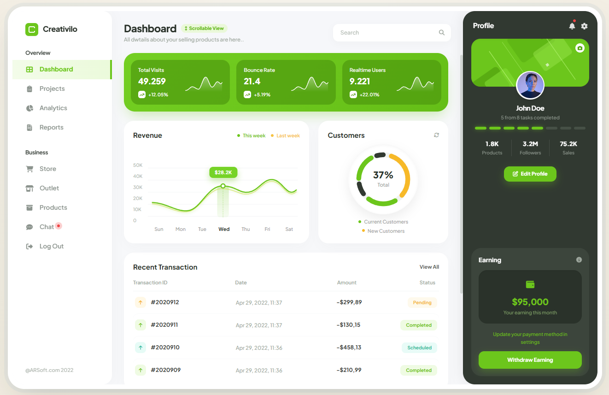

# Creativilo — SaaS Dashboard Template

Dashboard SaaS interaktif, frontend-only (vanilla JavaScript + Vite + Tailwind CSS via CDN).
Semua teks, angka, dan konten halaman diatur lewat file **data** — untuk rebrand/customize tidak perlu menyentuh kode komponen.

## Preview



## Fitur

- 9 halaman: Dashboard, Projects, Analytics, Reports, Store, Outlet, Products, Chat, Log Out
- SPA router sederhana: transisi view + glider sidebar + scroll progress
- Chart SVG interaktif (hover scrub), circular gauge, count-up KPI, toast, global search, modal
- Tanpa backend — semua data statis di `src/data/`

## Struktur Folder

```
creativilo_saas_dashboard/
├── index.html                  # Shell HTML + Tailwind config
├── vite.config.js              # base './' agar siap GitHub Pages
├── package.json
├── .github/workflows/deploy.yml
└── src/
    ├── main.js                 # Composition root + event delegation
    ├── config/
    │   └── app.js              # Branding, profil, rekening, notifikasi
    ├── data/                   # SEMUA konten halaman (edit di sini)
    │   ├── menu.js
    │   ├── dashboard.js
    │   ├── projects.js
    │   ├── analytics.js
    │   ├── reports.js
    │   ├── store.js
    │   ├── outlet.js
    │   ├── products.js
    │   └── chat.js
    ├── core/
    │   ├── router.js           # Pindah menu + glider + scroll progress
    │   ├── state.js            # State mutable bersama
    │   ├── toast.js
    │   └── search.js
    ├── ui/
    │   ├── shell.js            # Kerangka: bezel + kolom + modal + toast
    │   ├── sidebar.js
    │   ├── header.js
    │   ├── rightPanel.js
    │   └── modals.js
    └── views/                  # Satu file render per halaman
        ├── dashboard.js
        ├── projects.js
        ├── analytics.js
        ├── reports.js
        ├── store.js
        ├── outlet.js
        ├── products.js
        ├── chat.js
        └── logout.js
```

## Menjalankan

```bash
npm install
npm run dev        # development server dengan HMR
```

## Build Produksi

```bash
npm run build      # output ke dist/
npm run preview    # pratinjau hasil build
```

## Kustomisasi untuk Pengguna Template

| Yang diubah | File |
|---|---|
| Nama brand, footer, profil, avatar, rekening, notifikasi | `src/config/app.js` |
| Menu, judul, subtitle, icon, hasil pencarian | `src/data/menu.js` |
| KPI, chart revenue, transaksi dashboard | `src/data/dashboard.js` |
| Konten tiap halaman | `src/data/*.js` |
| Warna tema | `tailwind.config` di `index.html` |

### Menambah menu baru

1. Daftarkan di `MENU_META` + `MENU_GROUPS` (`src/data/menu.js`)
2. Buat `src/views/<menu>.js` dengan fungsi `render<Menu>View()`
3. Daftarkan view di `VIEWS` (`src/core/router.js`)

## Deploy ke GitHub Pages

Workflow `.github/workflows/deploy.yml` sudah disiapkan: push ke branch `main` → build otomatis → publish `dist/`.

Aktifkan di repository: **Settings → Pages → Source → GitHub Actions**.

### Push ke GitHub

```bash
git init
git add .
git commit -m "first commit"
git branch -M main
git remote add origin https://github.com/LALUARIFTA/creativilo_saas_dashboard.git
git push -u origin main
```

